<div align="center">

<picture>
  <source media="(prefers-color-scheme: dark)" srcset="assets/banner.svg">
  <source media="(prefers-color-scheme: light)" srcset="assets/banner-light.svg">
  
</picture>

[](LICENSE)
[](#instalação)
[](#uso)
[](#a-tabela)
[](https://uniqai.app/?utm_source=github&utm_medium=readme-pt-br&utm_campaign=ai-video-pricing)

# ai-video-pricing: quanto custa um segundo de vídeo com IA, Kling vs Veo vs Runway vs Luma

**Dólares por segundo de vídeo com IA, tirados da página de preços de cada fornecedor, com a fórmula, a URL de origem e a data de verificação em cada linha.**

[A tabela](#a-tabela) · [Como funciona](#como-funciona) · [Uso](#uso) · [Instalação](#instalação) · [Mantendo atualizado](#mantendo-atualizado) · [FAQ](#faq)

</div>

[English](README.md) · [Русский](README.ru.md) · [简体中文](README.zh-CN.md) · [Español](README.es.md) · Português (BR) · [日本語](README.ja.md) · [한국어](README.ko.md) · [Deutsch](README.de.md)

Custo por segundo de vídeo com IA para Kling 3.0, Veo 3 e 3.1, Runway Gen-4.5, Luma Ray3.2, Pika, MiniMax Hailuo e H3, Seedance via BytePlus, Higgsfield, Google Flow, a API do Gemini e UniqAI, verificado em 2026-10-28, com uma URL de origem em cada linha. Os fornecedores vendem planos e créditos, não segundos, então a tabela divide o que você paga pelos segundos que recebe e mostra a conta dentro da célula. Os dados estão em JSON e CSV sob CC BY 4.0; uma CLI em Node sem dependências filtra, recalcula, cota o seu próprio plano e lista as linhas que já passaram do prazo de revisão. A explicação completa, com os mesmos números, está em [uniqai.app](https://uniqai.app/video/ai-video-cost-per-second?utm_source=github&utm_medium=readme-pt-br&utm_campaign=ai-video-pricing).

| **Uma fórmula, à vista** | **Só páginas dos fornecedores** | **Linhas vencidas são sinalizadas** |
|:---|:---|:---|
| `(créditos por clipe × $ por crédito) ÷ segundos entregues`, impressa ao lado de cada número, recalculada pela CLI, nunca digitada à mão. | Cada linha aponta para a página de preços do próprio fornecedor e a data em que foi lida. Preços mostrados só dentro de um app ficam como `not published`, não como chute. | `avp stale` lista as linhas com mais de 30 dias; uma GitHub Action mensal transforma isso em uma issue com checklist. |

## Início rápido

```bash
git clone https://github.com/uniqaiapp/ai-video-pricing && cd ai-video-pricing
node scripts/avp.mjs cheapest --resolution 720p
node scripts/avp.mjs quote --plan-price 15 --credits 625 --credits-per-second 12
```

O primeiro comando imprime as cinco linhas publicadas mais baratas em 720p com as fórmulas; o segundo transforma um plano ("$15 por 625 créditos, 12 créditos por segundo") em $0.288 por segundo, $0.024 por crédito e $17.28 por minuto. Node 18 ou mais novo, nada para instalar.

## Demo



## A tabela

Ordenada por preço por segundo. Clipe = segundos entregues, resolução e áudio como o fornecedor declara; compare duas células só quando a coluna de clipe bate. `not published` significa que o fornecedor mostra o preço apenas dentro do app ou do console. Gerada por `node scripts/avp.mjs readme --write` a partir de [`data/prices.json`](data/prices.json); um teste falha se esta tabela e os dados divergirem.

<!-- prices:start -->
| Serviço | Modelo | Clipe | Base do preço | $ / s | Fórmula | Fonte | Verificado |
|---|---|---|---|---:|---|---|---|
| **BytePlus ModelArk API** | Seedance 1.0 Pro Fast | 5 s, 480p | pay-as-you-go, per clip | **$0.010** | $0.05 ÷ 5 s | [ModelArk pricing](https://ai.byteplus.com/ark/region:ap-southeast-1/docs/model-pricing) | 2026-10-28 |
| **Luma app** | Ray3.2 Draft | 5 s, 360p | Plus plan ($30/mo, 10,000 credits) | **$0.012** | 20 cr × ($30.00 ÷ 10,000 cr) ÷ 5 s | [Luma pricing](https://lumalabs.ai/pricing) | 2026-10-28 |
| **BytePlus ModelArk API** | Seedance 1.0 Pro Fast | 5 s, 720p | pay-as-you-go, per clip | **$0.020** | $0.10 ÷ 5 s | [ModelArk pricing](https://ai.byteplus.com/ark/region:ap-southeast-1/docs/model-pricing) | 2026-10-28 |
| **UniqAI** | Wan 2.5 | 5 s, no audio | 7,000-Gem pack ($19.99, needs an active plan) | **$0.023** | 40 cr × ($19.99 ÷ 7,000 cr) ÷ 5 s | [UniqAI pricing](https://uniqai.app/pricing) | 2026-10-28 |
| **Google Flow** | Veo 3.1 Lite | 8 s, audio | Google AI Pro ($19.99/mo, 1,000 Flow credits) | **$0.025** | 10 cr × ($19.99 ÷ 1,000 cr) ÷ 8 s | [Flow credits](https://support.google.com/flow/answer/16526234?hl=en) | 2026-10-28 |
| **MiniMax API** | MiniMax H3-Lite | 480p | pay-as-you-go, per second of output | **$0.025** | $0.025/s published | [MiniMax video pricing](https://platform.minimax.io/docs/guides/pricing-video) | 2026-10-28 |
| **Google Flow** | Gemini Omni Flash | 8 s, 720p | Google AI Pro ($19.99/mo, 1,000 Flow credits) | **$0.030** | 12 cr × ($19.99 ÷ 1,000 cr) ÷ 8 s | [Flow credits](https://support.google.com/flow/answer/16526234?hl=en) | 2026-10-28 |
| **Luma API** | Ray3.2 | 5 s, 540p | pay-as-you-go, per 5-second block | **$0.030** | $0.15 ÷ 5 s | [Luma API pricing](https://lumalabs.ai/api/pricing) | 2026-10-28 |
| **MiniMax API** | Hailuo 2.3 Fast | 6 s, 768p | pay-as-you-go, per clip | **$0.032** | $0.19 ÷ 6 s | [MiniMax video pricing](https://platform.minimax.io/docs/guides/pricing-video) | 2026-10-28 |
| **UniqAI** | Wan 2.5 | 5 s, no audio | 1,000-Gem pack ($4.99) | **$0.040** | 40 cr × ($4.99 ÷ 1,000 cr) ÷ 5 s | [UniqAI pricing](https://uniqai.app/pricing) | 2026-10-28 |
| **MiniMax API** | MiniMax H3-Lite | 768p | pay-as-you-go, per second of output | **$0.040** | $0.04/s published | [MiniMax video pricing](https://platform.minimax.io/docs/guides/pricing-video) | 2026-10-28 |
| **BytePlus ModelArk API** | Seedance 2.0 Mini | 480p | pay-as-you-go (token-billed; BytePlus publishes the per-second equivalent) | **$0.040** | $0.04/s published | [ModelArk pricing](https://ai.byteplus.com/ark/region:ap-southeast-1/docs/model-pricing) | 2026-10-28 |
| **UniqAI** | Kling 3.0 | 5 s | 7,000-Gem pack ($19.99, needs an active plan) | **$0.046** | 80 cr × ($19.99 ÷ 7,000 cr) ÷ 5 s | [UniqAI pricing](https://uniqai.app/pricing) | 2026-10-28 |
| **MiniMax API** | Hailuo 2.3 | 6 s, 768p | pay-as-you-go, per clip | **$0.047** | $0.28 ÷ 6 s | [MiniMax video pricing](https://platform.minimax.io/docs/guides/pricing-video) | 2026-10-28 |
| **BytePlus ModelArk API** | Seedance 1.0 Pro Fast | 5 s, 1080p | pay-as-you-go, per clip | **$0.048** | $0.24 ÷ 5 s | [ModelArk pricing](https://ai.byteplus.com/ark/region:ap-southeast-1/docs/model-pricing) | 2026-10-28 |
| **Google Flow** | Veo 3.1 Fast | 8 s, audio | Google AI Pro ($19.99/mo, 1,000 Flow credits) | **$0.050** | 20 cr × ($19.99 ÷ 1,000 cr) ÷ 8 s | [Flow credits](https://support.google.com/flow/answer/16526234?hl=en) | 2026-10-28 |
| **Runway API** | Gen-4 Turbo | — | pay-as-you-go ($0.01 per credit) | **$0.050** | 5 cr/s × $0.01/cr | [Runway API pricing](https://docs.dev.runwayml.com/guides/pricing/) | 2026-10-28 |
| **MiniMax API** | Hailuo 2.3 | 10 s, 768p | pay-as-you-go, per clip | **$0.056** | $0.56 ÷ 10 s | [MiniMax video pricing](https://platform.minimax.io/docs/guides/pricing-video) | 2026-10-28 |
| **Luma app** | Ray3.2 | 5 s, 720p | Plus plan ($30/mo, 10,000 credits) | **$0.060** | 100 cr × ($30.00 ÷ 10,000 cr) ÷ 5 s | [Luma pricing](https://lumalabs.ai/pricing) | 2026-10-28 |
| **Luma API** | Ray3.2 | 5 s, 720p | pay-as-you-go, per 5-second block | **$0.060** | $0.30 ÷ 5 s | [Luma API pricing](https://lumalabs.ai/api/pricing) | 2026-10-28 |
| **BytePlus ModelArk API** | Seedance 2.0 | 480p | pay-as-you-go (token-billed; BytePlus publishes the per-second equivalent) | **$0.070** | $0.07/s published | [ModelArk pricing](https://ai.byteplus.com/ark/region:ap-southeast-1/docs/model-pricing) | 2026-10-28 |
| **Luma app** | Seedance 2.0 | 480p, audio | Plus plan ($30/mo, 10,000 credits) | **$0.072** | 24 cr/s × ($30.00 ÷ 10,000 cr) | [Luma pricing](https://lumalabs.ai/pricing) | 2026-10-28 |
| **Pika** | Wan 3.0 | 5 s, 720p | Starter plan ($10/mo, 900 credits) | **$0.073** | 33 cr × ($10.00 ÷ 900 cr) ÷ 5 s | [Pika pricing](https://pika.art/pricing) | 2026-10-28 |
| **UniqAI** | Kling 3.0 | 8 s | 1,000-Gem pack ($4.99) | **$0.075** | 120 cr × ($4.99 ÷ 1,000 cr) ÷ 8 s | [UniqAI pricing](https://uniqai.app/pricing) | 2026-10-28 |
| **UniqAI** | Kling 3.0 | 5 s | 1,000-Gem pack ($4.99) | **$0.080** | 80 cr × ($4.99 ÷ 1,000 cr) ÷ 5 s | [UniqAI pricing](https://uniqai.app/pricing) | 2026-10-28 |
| **MiniMax API** | MiniMax H3 | 768p | pay-as-you-go, per second of output | **$0.080** | $0.08/s published | [MiniMax video pricing](https://platform.minimax.io/docs/guides/pricing-video) | 2026-10-28 |
| **BytePlus ModelArk API** | Seedance 2.0 Mini | 720p | pay-as-you-go (token-billed; BytePlus publishes the per-second equivalent) | **$0.080** | $0.08/s published | [ModelArk pricing](https://ai.byteplus.com/ark/region:ap-southeast-1/docs/model-pricing) | 2026-10-28 |
| **MiniMax API** | Hailuo 2.3 | 6 s, 1080p | pay-as-you-go, per clip | **$0.082** | $0.49 ÷ 6 s | [MiniMax video pricing](https://platform.minimax.io/docs/guides/pricing-video) | 2026-10-28 |
| **Runway API** | Kling 3.0 | no audio | pay-as-you-go ($0.01 per credit), Standard | **$0.090** | 9 cr/s × $0.01/cr | [Runway API pricing](https://docs.dev.runwayml.com/guides/pricing/) | 2026-10-28 |
| **Gemini API** | Gemini Omni Flash | 720p | pay-as-you-go ($17.50 per 1M output tokens) | **$0.101** | 5,792 tok/s × $17.50 ÷ 1M | [Gemini API pricing](https://ai.google.dev/gemini-api/docs/pricing), 2026-10-27 | 2026-10-28 |
| **Pika** | Wan 3.0 | 5 s, 720p | top-up ($1 per 60 credits) | **$0.110** | 33 cr × ($1.00 ÷ 60 cr) ÷ 5 s | [Pika pricing](https://pika.art/pricing) | 2026-10-28 |
| **Runway app** | Gen-4.5 | — | Max plan ($95/mo, 9,500 credits) | **$0.120** | 12 cr/s × ($95.00 ÷ 9,500 cr) | [Runway pricing](https://runway.com/pricing) | 2026-10-28 |
| **Runway API** | Gen-4.5 | — | pay-as-you-go ($0.01 per credit) | **$0.120** | 12 cr/s × $0.01/cr | [Runway API pricing](https://docs.dev.runwayml.com/guides/pricing/) | 2026-10-28 |
| **Runway API** | Kling 3.0 | audio | pay-as-you-go ($0.01 per credit), Standard with audio | **$0.130** | 13 cr/s × $0.01/cr | [Runway API pricing](https://docs.dev.runwayml.com/guides/pricing/) | 2026-10-28 |
| **MiniMax API** | MiniMax H3 | 2K | pay-as-you-go, per second of output | **$0.130** | $0.13/s published | [MiniMax video pricing](https://platform.minimax.io/docs/guides/pricing-video) | 2026-10-28 |
| **Luma app** | Kling 3.0 | 1080p, audio | Plus plan ($30/mo, 10,000 credits) | **$0.147** | 49 cr/s × ($30.00 ÷ 10,000 cr) | [Luma pricing](https://lumalabs.ai/pricing) | 2026-10-28 |
| **BytePlus ModelArk API** | Seedance 2.0 | 720p | pay-as-you-go (token-billed; BytePlus publishes the per-second equivalent) | **$0.150** | $0.15/s published | [ModelArk pricing](https://ai.byteplus.com/ark/region:ap-southeast-1/docs/model-pricing) | 2026-10-28 |
| **Runway API** | Kling 3.0 | audio | pay-as-you-go ($0.01 per credit), Pro with audio | **$0.170** | 17 cr/s × $0.01/cr | [Runway API pricing](https://docs.dev.runwayml.com/guides/pricing/) | 2026-10-28 |
| **Kling app** | Kling 3.0 | 4K | Ultra plan ($159.99/mo, 26,000 credits) | **$0.185** | 30 cr/s × ($159.99 ÷ 26,000 cr) | [Kling 3.0 credit cost guide](https://kling.ai/blog/kling-video-3-0-credit-cost-guide), 2026-07-28 | 2026-10-28 |
| **BytePlus ModelArk API** | Seedance 2.5 | 720p | pay-as-you-go (token-billed; BytePlus publishes the per-second equivalent) | **$0.231** | $0.231/s published | [ModelArk pricing](https://ai.byteplus.com/ark/region:ap-southeast-1/docs/model-pricing) | 2026-10-28 |
| **Luma app** | Ray3.2 | 5 s, 1080p | Plus plan ($30/mo, 10,000 credits) | **$0.240** | 400 cr × ($30.00 ÷ 10,000 cr) ÷ 5 s | [Luma pricing](https://lumalabs.ai/pricing) | 2026-10-28 |
| **Luma API** | Ray3.2 | 5 s, 1080p | pay-as-you-go, per 5-second block | **$0.240** | $1.20 ÷ 5 s | [Luma API pricing](https://lumalabs.ai/api/pricing) | 2026-10-28 |
| **Google Flow** | Veo 3.1 Quality | 8 s, audio | Google AI Pro ($19.99/mo, 1,000 Flow credits) | **$0.250** | 100 cr × ($19.99 ÷ 1,000 cr) ÷ 8 s | [Flow credits](https://support.google.com/flow/answer/16526234?hl=en) | 2026-10-28 |
| **Higgsfield** | Seedance 2.0 | 5 s, 720p | Ultra plan ($129/mo, 3,000 credits) | **$0.258** | 30 cr × ($129.00 ÷ 3,000 cr) ÷ 5 s | [Higgsfield pricing explained](https://higgsfield.ai/blog/higgsfield-pricing-explained), 2026-10-24 | 2026-10-28 |
| **Pika** | Seedance 2.5 | 5 s, 720p | Starter plan ($10/mo, 900 credits) | **$0.271** | 122 cr × ($10.00 ÷ 900 cr) ÷ 5 s | [Pika pricing](https://pika.art/pricing) | 2026-10-28 |
| **Runway app** | Gen-4.5 | — | Standard plan ($15/mo, 625 credits) | **$0.288** | 12 cr/s × ($15.00 ÷ 625 cr) | [Runway pricing](https://runway.com/pricing) | 2026-10-28 |
| **Higgsfield** | Seedance 2.0 | 5 s, 720p | Plus plan ($49/mo, 1,000 credits) | **$0.294** | 30 cr × ($49.00 ÷ 1,000 cr) ÷ 5 s | [Higgsfield pricing explained](https://higgsfield.ai/blog/higgsfield-pricing-explained), 2026-10-24 | 2026-10-28 |
| **Runway API** | Seedance 2.0 | 720p | pay-as-you-go | **$0.300** | $0.30/s published | [Runway API pricing](https://docs.dev.runwayml.com/guides/pricing/) | 2026-10-28 |
| **Higgsfield** | Veo 3 | 8 s, 720p, audio | Plus plan ($49/mo, 1,000 credits) | **≈ $0.355** | 58 cr × ($49.00 ÷ 1,000 cr) ÷ 8 s | [Higgsfield pricing explained](https://higgsfield.ai/blog/higgsfield-pricing-explained), 2026-10-24 | 2026-10-28 |
| **BytePlus ModelArk API** | Seedance 2.0 | 1080p | pay-as-you-go (token-billed; BytePlus publishes the per-second equivalent) | **$0.370** | $0.37/s published | [ModelArk pricing](https://ai.byteplus.com/ark/region:ap-southeast-1/docs/model-pricing) | 2026-10-28 |
| **UniqAI** | Veo 3 | 6 s, audio | 30-Cinema pack ($69.99, needs an active plan) | **$0.389** | 1 cr × ($69.99 ÷ 30 cr) ÷ 6 s | [UniqAI pricing](https://uniqai.app/pricing) | 2026-10-28 |
| **UniqAI** | Veo 3 | 6 s, audio | 5-Cinema pack ($11.99) | **$0.400** | 1 cr × ($11.99 ÷ 5 cr) ÷ 6 s | [UniqAI pricing](https://uniqai.app/pricing) | 2026-10-28 |
| **Kling app** | Kling 3.0 | 4K | Standard plan ($8.80/mo, 660 credits) | **$0.400** | 30 cr/s × ($8.80 ÷ 660 cr) | [Kling 3.0 credit cost guide](https://kling.ai/blog/kling-video-3-0-credit-cost-guide), 2026-07-28 | 2026-10-28 |
| **Runway API** | Seedance 2.0 | 1080p | pay-as-you-go | **$0.400** | $0.40/s published | [Runway API pricing](https://docs.dev.runwayml.com/guides/pricing/) | 2026-10-28 |
| **Pika** | Seedance 2.5 | 5 s, 720p | top-up ($1 per 60 credits) | **$0.407** | 122 cr × ($1.00 ÷ 60 cr) ÷ 5 s | [Pika pricing](https://pika.art/pricing) | 2026-10-28 |
| **Luma app** | Veo 3.1 | 720p, no audio | Plus plan ($30/mo, 10,000 credits) | **$0.420** | 140 cr/s × ($30.00 ÷ 10,000 cr) | [Luma pricing](https://lumalabs.ai/pricing) | 2026-10-28 |
| **Runway API** | Kling 3.0 | 4K | pay-as-you-go ($0.01 per credit), 4K | **$0.430** | 43 cr/s × $0.01/cr | [Runway API pricing](https://docs.dev.runwayml.com/guides/pricing/) | 2026-10-28 |
| **Higgsfield** | Seedance 2.0 | 5 s, 720p | Starter plan ($15/mo, 200 credits) | **$0.450** | 30 cr × ($15.00 ÷ 200 cr) ÷ 5 s | [Higgsfield pricing explained](https://higgsfield.ai/blog/higgsfield-pricing-explained), 2026-10-24 | 2026-10-28 |
| **Higgsfield** | Seedance 2.0 | 5 s, 1080p | Plus plan ($49/mo, 1,000 credits) | **$0.588** | 60 cr × ($49.00 ÷ 1,000 cr) ÷ 5 s | [Higgsfield pricing explained](https://higgsfield.ai/blog/higgsfield-pricing-explained), 2026-10-24 | 2026-10-28 |
| **UniqAI** | Veo 3 | 8 s, audio | 5-Cinema pack ($11.99) | **$0.600** | 2 cr × ($11.99 ÷ 5 cr) ÷ 8 s | [UniqAI pricing](https://uniqai.app/pricing) | 2026-10-28 |
| **BytePlus ModelArk API** | Seedance 2.0 | 4K | pay-as-you-go (token-billed; BytePlus publishes the per-second equivalent) | **$0.780** | $0.78/s published | [ModelArk pricing](https://ai.byteplus.com/ark/region:ap-southeast-1/docs/model-pricing) | 2026-10-28 |
| **Luma app** | Seedance 2.0 | 4K | Plus plan ($30/mo, 10,000 credits) | **$0.783** | 261 cr/s × ($30.00 ÷ 10,000 cr) | [Luma pricing](https://lumalabs.ai/pricing) | 2026-10-28 |
| **Higgsfield** | Seedance 2.0 | 5 s, 4K | Plus plan ($49/mo, 1,000 credits) | **$1.274** | 130 cr × ($49.00 ÷ 1,000 cr) ÷ 5 s | [Higgsfield pricing explained](https://higgsfield.ai/blog/higgsfield-pricing-explained), 2026-10-24 | 2026-10-28 |
| **Runway API** | Seedance 2.0 | 4K | pay-as-you-go | **$1.500** | $1.50/s published | [Runway API pricing](https://docs.dev.runwayml.com/guides/pricing/) | 2026-10-28 |
| **Kling app** | Kling 3.0 | 720p / 1080p | Standard, Pro, Premier and Ultra plans | **not published** | not published | [Kling credits policy](https://kling.ai/docs/point-policy) | 2026-10-28 |
| **Kling API** | Kling 3.0 | — | developer pricing | **not published** | not published | [Kling developer pricing](https://kling.ai/dev/pricing) | 2026-10-28 |
| **Hailuo app** | Hailuo 2.3 | — | subscription plans | **not published** | not published | [Hailuo subscribe](https://hailuoai.video/subscribe) | 2026-10-28 |
| **Higgsfield** | Kling 3.0 | 5 s, 720p | Plus and Ultra plans | **not published** | not published | [Higgsfield pricing explained](https://higgsfield.ai/blog/higgsfield-pricing-explained), 2026-10-24 | 2026-10-28 |
| **OpenAI** | Sora 2 | — | none | **—** | discontinued | [OpenAI deprecations](https://developers.openai.com/api/docs/deprecations), 2026-03-24 | 2026-10-28 |
<!-- prices:end -->

Preços em USD na cobrança mensal, lidos da página linkada na data da última coluna. Os valores por segundo são arredondados para três casas decimais. A página explicativa arredonda para o centavo, então `$0.288` lá aparece como `$0.29`; as entradas são idênticas. Regras completas: [references/methodology.md](references/methodology.md).

## Como funciona

1. `data/prices.json` guarda uma linha por serviço, modelo e configuração, com as entradas que o fornecedor de fato publica: preço do plano e créditos, créditos por clipe ou por segundo, segundos entregues, resolução, áudio, ou um preço direto por clipe, por segundo ou por token. A documentação dos campos está em [`data/schema.json`](data/schema.json).
2. `node scripts/avp.mjs recompute --write` preenche `usd_per_second` a partir dessas entradas com uma fórmula por tipo de cobrança. `validate` falha se um valor gravado difere do recalculado, se uma URL está malformada, se uma data não existe ou se uma linha publicada não tem as entradas que o seu tipo de cobrança exige.
3. `export`, `readme --write` e `scripts/examples.mjs` regeneram o CSV, a tabela deste README e os arquivos em `examples/`. Os testes comparam cada um com os dados byte a byte, então um número não consegue mudar em um lugar só.
4. `stale --days 30` lista as linhas com mais de 30 dias agrupadas por página de origem; `.github/workflows/price-recheck.yml` roda isso no dia 1 de cada mês e abre uma issue com checklist.

```
data/prices.json ──recompute──▶ usd_per_second ──export──▶ data/prices.csv
        │                                          ──readme──▶ README.md (this table)
        │                                          ──examples──▶ examples/*
        └──stale──▶ price-recheck issue (monthly)
```

## Uso

```bash
node scripts/avp.mjs table --max 0.10 --published --format text   # everything at or under 10 cents
node scripts/avp.mjs model "Kling 3.0"                             # the same model through every door
node scripts/avp.mjs cheapest --audio yes --brief                  # cheapest rows whose price includes audio
node scripts/avp.mjs table --door api --format csv > api.csv       # developer APIs only, as CSV
node scripts/avp.mjs quote --plan-price 30 --credits 10000 --credits-per-clip 100 --seconds 5
node scripts/avp.mjs quote --clip-price 0.28 --seconds 6
node scripts/avp.mjs stale --days 30                               # rows due for a recheck
node scripts/avp.mjs validate                                      # schema + arithmetic, exit 1 on errors
node scripts/avp.mjs --help
```

Filtros: `--service`, `--model`, `--maker`, `--door app|api`, `--resolution 720p`, `--audio yes|no`, `--max 0.10`, `--published`. Ordene com `--sort price|service|model|checked` e `--desc`; escolha a saída com `--format md|text|csv|json`. Os dados são JSON puro, então dá para pular a CLI: `JSON.parse(fs.readFileSync("data/prices.json"))` ou `pandas.read_csv("data/prices.csv")`.

## Exemplos

Cada arquivo em [`examples/`](examples/README.md) é a saída exata do comando indicado em [`examples/commands.json`](examples/commands.json), e a suíte de testes reproduz cada um deles.

<details>
<summary><b>Mesmo modelo, seis portas: Kling 3.0</b></summary>

`node scripts/avp.mjs model "Kling 3.0" --format text --brief`

```text
        $ / s  service     model      clip
-------------  ----------  ---------  ------------
       $0.046  UniqAI      Kling 3.0  5 s
       $0.075  UniqAI      Kling 3.0  8 s
       $0.080  UniqAI      Kling 3.0  5 s
       $0.090  Runway API  Kling 3.0  no audio
       $0.130  Runway API  Kling 3.0  audio
       $0.147  Luma app    Kling 3.0  1080p, audio
       $0.170  Runway API  Kling 3.0  audio
       $0.185  Kling app   Kling 3.0  4K
       $0.400  Kling app   Kling 3.0  4K
       $0.430  Runway API  Kling 3.0  4K
not published  Kling app   Kling 3.0  720p / 1080p
not published  Kling API   Kling 3.0  —
not published  Higgsfield  Kling 3.0  5 s, 720p
```

Versão completa com base do preço e fórmula: [`examples/kling-3-0-doors.md`](examples/kling-3-0-doors.md).

</details>

<details>
<summary><b>O seu próprio plano em dólares por segundo</b></summary>

`node scripts/avp.mjs quote --plan-price 4.99 --credits 1000 --credits-per-clip 80 --seconds 5`

```text
$ per second: 0.080
formula: 80 cr × ($4.99 ÷ 1,000 cr) ÷ 5 s
$ per credit: 0.00499
$ per clip (5 s): 0.399
$ per minute: 4.79
```

</details>

<details>
<summary><b>Como é a issue de lembrete mensal</b></summary>

`node scripts/avp.mjs stale --days 30 --as-of 2026-12-01` produz um checklist agrupado por página de origem; veja [`examples/stale-2026-12-01.md`](examples/stale-2026-12-01.md). Com os dados do repositório e a data de hoje, ele imprime `No rows older than 30 days.`

</details>

## Instalação

A CLI funciona sem agente nenhum. A skill instrui o agente a responder perguntas de preço com estes dados, não de memória, e a citar a fonte e a data da linha.

<details open>
<summary><b>Claude Code</b></summary>

```bash
git clone https://github.com/uniqaiapp/ai-video-pricing ~/.claude/skills/ai-video-pricing
```

Depois digite `/ai-video-pricing` em qualquer sessão, ou só pergunte "quanto custa um segundo de Kling"; a descrição da skill a aciona. Local ao projeto em vez de global: clone em `.claude/skills/ai-video-pricing` dentro do seu projeto. Quando o marketplace uniqaiapp for publicado: `/plugin marketplace add uniqaiapp/skills` e depois `/plugin install ai-video-pricing@uniqaiapp`.

</details>

<details>
<summary><b>Cursor</b></summary>

Copie [`.cursor/rules/ai-video-pricing.mdc`](.cursor/rules/ai-video-pricing.mdc) para o `.cursor/rules/` do seu projeto junto com `SKILL.md`, `scripts/`, `data/` e `references/`. O arquivo de regra embute a skill.

</details>

<details>
<summary><b>Codex / qualquer agente com AGENTS.md</b></summary>

Copie `SKILL.md`, `scripts/`, `data/` e `references/` para `.agents/skills/ai-video-pricing/` e adicione o trecho de [`codex/INSTRUCTIONS.md`](codex/INSTRUCTIONS.md) ao seu `AGENTS.md`.

</details>

<details>
<summary><b>Prompt simples</b></summary>

Cole [`SKILL.md`](SKILL.md) no system prompt de qualquer modelo que consiga rodar comandos de shell. Fora do frontmatter, não há sintaxe específica de agente.

</details>

## Mantendo atualizado

Os preços mudam todo mês. [`.github/workflows/price-recheck.yml`](.github/workflows/price-recheck.yml) roda no dia 1 de cada mês, lista todas as linhas com mais de 30 dias agrupadas por página de origem e abre uma issue `price-recheck` (ou comenta na que já estiver aberta) com um checklist. Um mantenedor relê cada página, atualiza as entradas e o `checked_on`, e roda:

```bash
node scripts/avp.mjs recompute --write && node scripts/avp.mjs validate
node scripts/avp.mjs export && node scripts/avp.mjs readme --write && node scripts/examples.mjs
node tests/run.mjs
```

Para reaproveitar o lembrete no seu próprio repositório de dados, copie o workflow e troque as duas linhas de `stale` por qualquer comando que imprima as suas linhas vencidas em Markdown.

## Limites e honestidade

- Cada número aqui foi lido da página do fornecedor linkada na data indicada ou calculado a partir desses números pela fórmula da célula. Nada é estimativa. Fornecedor que esconde o preço recebe uma linha `not_published`.
- O dataset precifica a saída paga na cobrança mensal padrão. Créditos grátis diários, promoções do primeiro mês, descontos anuais, marcas d'água, faixas de licença comercial, modos "ilimitados", acúmulo de créditos e mínimos de API mudam o preço efetivo para alguns usuários; eles estão em `notes` e na [metodologia](references/methodology.md), não no número.
- As linhas da própria UniqAI seguem a mesma regra de todo mundo: os dois pacotes que qualquer pessoa pode comprar sem plano, mais os maiores pacotes como piso. A UniqAI é uma das portas mais baratas para Kling 3.0 e Wan 2.5 e uma das mais caras para Veo 3; a tabela diz isso.
- As contagens de linhas, serviços e modelos neste README vêm de `node scripts/avp.mjs validate` (`ok: 69 rows, 64 published`) e dos exemplos. Não há números de uso, downloads ou popularidade aqui porque não temos números honestos.
- Os rótulos de resolução são os do fornecedor e não foram normalizados. O dataset está em USD e em inglês, e cobre os fornecedores listados acima; ele não se pretende completo.

## FAQ

<details>
<summary><b>Qual é o gerador de vídeo com IA mais barato por segundo?</b></summary>

Nas linhas verificadas em 2026-10-28, o Seedance 1.0 Pro Fast pela API BytePlus ModelArk em 480p ($0.05 por clipe de 5 segundos, $0.010 por segundo). Em 720p o piso fica entre $0.020 e $0.030 (Seedance 1.0 Pro Fast, Gemini Omni Flash no Google Flow). Rode `node scripts/avp.mjs cheapest --resolution 720p` para a lista atual com fórmulas.

</details>

<details>
<summary><b>Quanto custa o Kling 3.0 por segundo?</b></summary>

Depende da porta: $0.080 na UniqAI (clipe de 5 s, pacote de 1,000 Gems), $0.090 pela API da Runway sem áudio, $0.147 na Luma em 1080p com áudio, $0.400 em 4K no plano Standard do próprio Kling. O app do Kling não publica o custo em créditos de 720p e 1080p fora do painel de geração. `node scripts/avp.mjs model "Kling 3.0"` imprime tudo isso.

</details>

<details>
<summary><b>Por que o mesmo modelo tem preços tão diferentes?</b></summary>

Aritmética de plano. Um plano de $30 com 10,000 créditos e um plano de $15 com 625 créditos não podem ser comparados até você saber o que um crédito compra naquele modelo naquela resolução. Revendedores ainda adicionam mínimos (os 56 a 80 créditos por geração da Runway) e empacotam o áudio de formas diferentes. Dividir pelos segundos entregues é o único jeito de colocá-los lado a lado, e a coluna de clipe avisa quando a comparação ainda é injusta.

</details>

<details>
<summary><b>A OpenAI ainda vende o Sora?</b></summary>

Não. O app do Sora fechou em 2026-04-26 e a Videos API com sora-2 e sora-2-pro foi removida em 2026-09-24; a página de descontinuações da OpenAI não lista nenhum modelo de vídeo substituto, então o dataset traz uma linha `discontinued` em vez de um preço.

</details>

<details>
<summary><b>Posso usar estes dados no meu próprio artigo ou ferramenta?</b></summary>

Sim, sob CC BY 4.0: credite "UniqAI, https://github.com/uniqaiapp/ai-video-pricing" e mantenha a data de verificação visível para que os leitores saibam a idade dos números. [`CITATION.cff`](CITATION.cff) tem uma citação legível por máquina. Os scripts são MIT.

</details>

## Relacionados

- [awesome-ai-video-prompts](https://github.com/uniqaiapp/awesome-ai-video-prompts): prompts curados e categorizados para modelos de vídeo com IA, com as configurações que os produziram, em JSON e Markdown.
- [video-director](https://github.com/uniqaiapp/video-director): transforma uma ideia de uma linha em um prompt plano a plano para modelos de vídeo com IA (Kling, Veo, Sora e outros), com vocabulário de câmera, iluminação e movimento.
- [model-router](https://github.com/uniqaiapp/model-router): escolhe o modelo mais barato que dá conta da tarefa: uma tabela de regras e um script de biblioteca padrão que roteia tarefas por tipo, tamanho e risco.

## Contribuindo

Correções são bem-vindas como issues ou pull requests; o template [price correction](.github/ISSUE_TEMPLATE/price_correction.md) pede a URL do fornecedor e a linha que você leu. Veja [CONTRIBUTING.md](CONTRIBUTING.md) para o ciclo de regenerar e testar (`node tests/run.mjs`, sem dependências).

## Licença

Os dados (`data/`, `examples/`, `references/`) são [CC BY 4.0](LICENSE); os scripts e todo o resto são [MIT](LICENSE). © UniqAI

---

<div align="center">

<sub>Feito pela <a href="https://uniqai.app/?utm_source=github&utm_medium=readme-pt-br&utm_campaign=ai-video-pricing">UniqAI</a>, um app de foto, vídeo e chat com IA. Acompanhamos o preço por segundo de cada fornecedor para definir o nosso, então a tabela é mantida de qualquer jeito.</sub>

</div>
